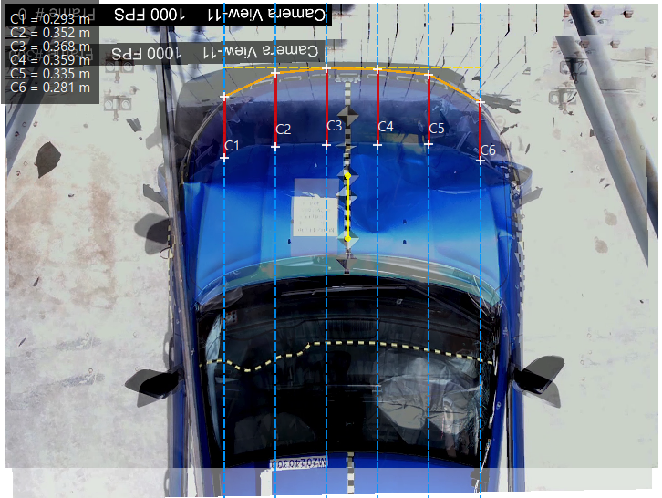

# CRASH3Vision

🇺🇸 [**English**](README.md) | 🇧🇷 [**Português (Brasil)**](README.pt-BR.md)

**Mensuração semiassistida de deformações veiculares por imagens e estimativa de energia de deformação e EES pelo método CRASH3**

O CRASH3Vision é um software experimental de pesquisa desenvolvido para auxiliar na extração de parâmetros de deformação estrutural veicular a partir de imagens digitais e na aplicação desses parâmetros à estimativa da energia de deformação e da velocidade equivalente em energia (EES, do inglês Energy Equivalent Speed), por métodos derivados do CRASH3.

O projeto reúne **Engenharia Forense, análise de imagens digitais, reconstrução de colisões veiculares e software de pesquisa reprodutível**.

> **Status atual** — v1.1.0, versão pública de pesquisa publicada em 28/11/2026\
> **Estágio da pesquisa** — validação experimental preliminar / prova de conceito\
> **Escopo atual da validação** — deformação veicular frontal\
> **Licença** — PolyForm Noncommercial License 1.0.0

<p align="center">
  
</p>

## Links rápidos

- [Metodologia](docs/methodology.md)
- [Validação experimental](docs/validation.md)
- [Metadados de citação](CITATION.cff)
- [Licença](LICENSE)
- [Avisos de terceiros](THIRD_PARTY_NOTICES)
- [Versões públicas](https://github.com/brunopneves/crash3vision/releases)

---

## Visão geral

A reconstrução de colisões veiculares frequentemente se baseia em medições da deformação estrutural permanente. Nos procedimentos convencionais, essas medições costumam ser realizadas manualmente em campo, o que pode impor limitações operacionais de acesso, repetibilidade das medições, documentação e verificação posterior.

O CRASH3Vision implementa um fluxo de trabalho semiassistido com imagens digitais e reúne as seguintes etapas e recursos.

- Calibração geométrica das imagens
- Alinhamento das imagens de referência e do veículo danificado
- Mensuração da largura total da região deformada (**W**)
- Mensuração de seis profundidades de deformação estrutural (**C1–C6**)
- Representação opcional do deslocamento da referência estrutural
- Gerenciamento dos coeficientes de rigidez veicular (**A/B**)
- Cálculo da energia de deformação por método derivado do CRASH3
- Estimativa da velocidade equivalente em energia (**EES**)
- Rastreabilidade das medições e dos cálculos
- Geração de relatórios técnicos

O software foi desenvolvido especificamente para operacionalizar e avaliar experimentalmente essa metodologia.

---

## Motivação científica

As medições convencionais de deformação podem ser afetadas pela interpretação do operador, pelo acesso limitado às estruturas danificadas, pelo tempo disponível e pela ausência de documentação geométrica padronizada.

Os fluxos de trabalho baseados em imagens permitem preservar os registros visuais originais e possibilitam a revisão e a reprodução posterior das medições.

A pesquisa que fundamenta o CRASH3Vision investiga se uma abordagem semiassistida, de baixo custo e baseada em imagens pode fornecer parâmetros de deformação úteis e melhorar a documentação, a rastreabilidade e a eficiência operacional.

---

## Avaliação experimental

A metodologia foi avaliada preliminarmente em duas fases complementares, concebidas para responder a questões distintas.

### Fase 1 — Dados controlados de ensaios de colisão da NHTSA

Foram utilizadas imagens oficiais de ensaios de colisão da NHTSA como referência técnica.

A amostra foi limitada pela disponibilidade de ensaios da NHTSA com câmeras em vista superior ou em posição próxima ao nadir, adequadas à mensuração de deformações por imagens. Foram identificados cinco ensaios com veículos compatíveis com esses critérios.

Para ampliar a replicação das medições nessa amostra limitada, três peritos criminais realizaram três medições independentes por veículo.

- **5 modelos de veículos**
- **3 peritos criminais**
- **3 medições independentes por perito/modelo**
- **N = 45 medições**
- **MAPE global da EES de 3.52%**

O objetivo desta fase foi estimar o erro associado à substituição das medições convencionais de deformação por medições extraídas de imagens, utilizando como referência controlada os valores de EES informados na documentação dos respectivos ensaios de colisão da NHTSA.

### Fase 2 — Imagens de casos reais obtidas por UAV

Foram analisadas imagens de veículos danificados obtidas com veículos aéreos não tripulados (UAVs) e comparadas as medições obtidas dessas imagens com as medições convencionais de campo.

A amostra de campo foi limitada a três veículos danificados adequados à análise e disponíveis durante o período do estudo. Por isso, esta fase foi concebida como uma prova de conceito preliminar em condições operacionais. Uma validação em larga escala estava fora do escopo dessa fase.

- **3 veículos de casos reais**
- **3 peritos criminais**
- **3 medições independentes por perito/modelo**
- **N = 27 medições**
- **MAPE global da EES de 4.60%**

O objetivo desta fase foi avaliar o fluxo de trabalho em um contexto pericial realista, comparando as medições obtidas de imagens com as realizadas manualmente em campo.

No total, o conjunto de dados experimentais reuniu **72 medições independentes**.

O fluxo de trabalho baseado em imagens também reduziu o tempo médio para obtenção dos parâmetros de deformação de **19.3 min para 11.1 min por veículo**, o que corresponde a uma redução observada de aproximadamente **40.9%** nas condições testadas.

| Resultado experimental | Valor |
|---|---:|
| MAPE global da Fase 1 | **3.52%** |
| MAPE global da Fase 2 | **4.60%** |
| Total de medições independentes | **72** |
| Redução do tempo médio de medição | **40.9%** |

Esses resultados devem ser interpretados dentro do escopo experimental e das limitações descritas em [Validação experimental](docs/validation.md).

---

## Visão geral do método

O fluxo de trabalho implementado no CRASH3Vision segue a sequência geral abaixo.

1. Carregar uma imagem de referência e/ou uma imagem do veículo danificado.
2. Alinhar as imagens quando houver uma imagem de referência.
3. Calibrar a escala da imagem.
4. Definir a largura da região deformada (**W**).
5. Dividir W em cinco intervalos iguais.
6. Mensurar as seis profundidades de deformação (**C1–C6**).
7. Definir ou recuperar os coeficientes de rigidez estrutural (**A/B**).
8. Calcular a energia de deformação.
9. Estimar a EES.
10. Salvar as medições, os dados do projeto e os resultados técnicos.

Para padronizar a marcação, a dianteira do veículo deve estar voltada para cima na imagem, com C1–C6 atribuídos da esquerda para a direita.

**Aquisição de imagens.** Dê preferência a imagens de alta resolução obtidas quase diretamente acima do veículo (próximas ao nadir), com distorção geométrica mínima e boa visibilidade dos elementos estruturais usados para medir W e C1–C6. Na avaliação com veículos de casos reais, foram utilizadas imagens de drone captadas a cerca de 10 m acima do solo. A avaliação com dados da NHTSA usou gravações de câmeras instaladas acima dos veículos nos ensaios, com perspectiva semelhante. A resolução efetiva, a perspectiva e a calibração adequada são mais importantes do que a altura de voo isoladamente. Seguir essas recomendações é insuficiente, por si só, para garantir a exatidão das medições.

Seis ordenadas de deformação definem cinco intervalos ao longo da largura deformada. Assim, a largura de cada intervalo é **W/5**.

Quando pertinente, a metodologia também permite usar um deslocamento da referência estrutural associado ao reforço ou à travessa do para-choque.

Para uma descrição mais detalhada, consulte a [Metodologia](docs/methodology.md).

---

## Funcionalidades

- Fluxos de trabalho com uma ou duas imagens
- Alinhamento da imagem de referência com a imagem do veículo deformado
- Sobreposição semitransparente com controles de ajuste fino da posição, rotação e escala
- Calibração geométrica com referências métricas conhecidas
- Mensuração semiassistida de **W** e **C1–C6**
- Linha opcional de deslocamento da travessa do para-choque como referência estrutural
- Cálculo de energia pela formulação estendida do CRASH3 em unidades do SI
- Cálculo da EES
- Visualização do perfil de deformação
- Coeficientes de rigidez estrutural obtidos por diferentes meios
  - Inserção manual
  - Classes genéricas de veículos para demonstração
  - Procedimento baseado em relatórios de ensaios de colisão da NHTSA
  - Biblioteca interna de coeficientes A/B da NHTSA
  - Importação e exportação de registros A/B em JSON
- Interface bilíngue (português / inglês)
- Exportação de relatório técnico com os dados de entrada das medições, a procedência dos coeficientes, os parâmetros de cálculo e os resultados para revisão posterior e auditoria técnica
- Salvamento e carregamento de projetos
- Exportação da área de visualização em PNG

---

## Metodologia e equações

A EES é estimada a partir da energia de deformação estrutural, com a formulação derivada do CRASH3 implementada no [núcleo de cálculo](app/core/crash3.py).

$$
\begin{aligned}
E &= \frac{W}{5}\left[\frac{A}{2}L + \frac{B}{6}Q + 5G\right]\left(1 + \tan^2\alpha\right), \\
L &= C_1 + 2C_2 + 2C_3 + 2C_4 + 2C_5 + C_6, \\
Q &= C_1^2 + 2C_2^2 + 2C_3^2 + 2C_4^2 + 2C_5^2 + C_6^2 \\
  &\quad {}+ C_1C_2 + C_2C_3 + C_3C_4 + C_4C_5 + C_5C_6, \\
G &= \frac{A^2}{2B}.
\end{aligned}
$$

Os símbolos representam as seguintes grandezas.

- `E` — energia de deformação (J)
- `C1..C6` — profundidades de deformação estrutural (m)
- `A`, `B` — coeficientes de rigidez estrutural do veículo (N/m e N/m²)
- `W` — largura da região deformada (m)
- `L`, `Q` — termos linear e quadrático ponderados da deformação (m e m², respectivamente)
- `G` — energia residual por unidade de largura (J/m)
- `α` — ângulo de impacto (informado em graus e convertido para radianos para o cálculo da tangente)

A EES é então obtida pela seguinte expressão.

```text
EES = √(2E / m)
```

Os coeficientes de rigidez A e B podem ser derivados de dados documentados de ensaios de colisão da NHTSA pelo procedimento implementado no software.

A descrição metodológica completa está em [docs/methodology.md](docs/methodology.md).

---

## Instalação

### Executável para Windows

O pacote portátil e o instalador por usuário da v1.1.0 para Windows x64 incluem o ambiente de execução do Python e o projeto de referência do Jeep Compass com as duas imagens. O instalador foi testado com sucesso em um segundo computador com Windows. A distribuição pública dos binários para Windows ainda depende de autorização para redistribuir os componentes de execução da Microsoft.

O [guia do instalador para Windows](docs/windows-installer.md) documenta as versões fixadas do ambiente de compilação, o empacotamento, a validação e o procedimento de limpeza.

### Execução a partir do código-fonte

- Python 3.10+
- PySide6, NumPy e OpenCV, instalados a partir de [`requirements.txt`](requirements.txt)

Clone o repositório.

```bash
git clone https://github.com/brunopneves/crash3vision.git
cd crash3vision
```

Crie e ative um ambiente virtual.

```bash
python -m venv .venv
```

No Windows, ative o ambiente com o comando abaixo.

```powershell
.\.venv\Scripts\Activate.ps1
```

Instale as dependências.

```bash
python -m pip install -r requirements.txt
```

Execute o aplicativo.

```bash
python -m app.main
```

---

## Estrutura do projeto

```text
crash3vision/
├── app/
│   ├── main.py
│   ├── version.py
│   ├── i18n.py
│   ├── core/
│   ├── ui/
│   │   ├── canvas/
│   │   ├── overlay/
│   │   ├── tools/
│   │   ├── controllers/
│   │   └── widgets/
│   ├── report/
│   ├── data/
│   │   ├── nhtsa_ab_library.json
│   │   └── stiffness_library.json
│   └── assets/
│       ├── welcome.png
│       └── crash3_icon.ico
├── docs/
│   ├── methodology.md
│   ├── validation.md
│   └── images/
│       └── crash3vision-overview.png
├── CHANGELOG.md
├── CITATION.cff
├── LICENSE
├── THIRD_PARTY_NOTICES
├── requirements.txt
└── README.md
```

---

## Coeficientes e recursos de demonstração

O arquivo `app/data/stiffness_library.json` contém **coeficientes exclusivamente ilustrativos**, destinados a demonstrar o fluxo de trabalho do software, incluindo as classes genéricas e os registros de veículos.

Esses valores têm caráter ilustrativo, sem validade como referência técnica oficial. Seu uso em aplicações periciais exige verificação independente em uma fonte apropriada.

A biblioteca poderá ser atualizada em versões futuras com valores documentados e acompanhados de referências.

Este aviso diz respeito à biblioteca genérica. A documentação dos registros derivados da NHTSA está em [`THIRD_PARTY_NOTICES`](THIRD_PARTY_NOTICES).

Os arquivos `app/assets/welcome.png` e `app/assets/crash3_icon.ico` são recursos originais criados pelo autor para o CRASH3Vision e redistribuídos com o projeto.

---

## Dados de exemplo

Um par de imagens da NHTSA, anterior e posterior ao impacto, está disponível em [`examples/nhtsa_jeep_compass_2024_m20240300/`](examples/nhtsa_jeep_compass_2024_m20240300/).

Essas imagens podem ser usadas para conhecer o CRASH3Vision e testar manualmente o fluxo de trabalho baseado em imagens.

---

## Dados do usuário

O aplicativo armazena os dados do usuário, incluindo a biblioteca pessoal de coeficientes A/B, nos seguintes caminhos.

- **Windows** — `%USERPROFILE%\.crash3vision\data\`
- **Linux/macOS** — `~/.crash3vision/data/`

Na primeira execução, a biblioteca distribuída com o aplicativo é copiada para o local correspondente. O usuário pode adicionar registros próprios na caixa de diálogo de coeficientes A/B da NHTSA. Esses registros são preservados independentemente das atualizações do software.

---

## Escopo atual e limitações

O CRASH3Vision deve ser considerado **software experimental de pesquisa**.

A validação descrita no estudo associado é preliminar e se concentra principalmente na deformação veicular frontal.

As limitações conhecidas são as seguintes.

- Tamanho limitado da amostra experimental
- Interpretação manual dos pontos de referência estruturais
- Dependência da resolução e do contraste das imagens
- Influência da perspectiva das imagens
- Dependência de coeficientes de rigidez apropriados
- Possível incerteza quando elementos estruturais internos estão parcialmente ocultos
- Validação atualmente concentrada em impactos frontais

Na Fase 1, o tamanho da amostra foi limitado pela disponibilidade de ensaios adequados da NHTSA com imagens em vista superior ou próximas ao nadir. Na Fase 2, a amostra foi limitada pela disponibilidade de veículos danificados de casos reais adequados à análise durante o período do estudo.

Por essas razões, os resultados atuais devem ser interpretados como uma **prova de conceito preliminar**. Uma validação definitiva que abranja todos os tipos de veículos, configurações de impacto ou condições operacionais ainda está fora do escopo dos resultados.

O CRASH3Vision deve, portanto, ser usado como **ferramenta experimental de apoio e de pesquisa**, em conjunto com a análise técnica de reconstrução, que permanece indispensável.

Consulte a [Validação experimental](docs/validation.md) para ver o delineamento do estudo, os resultados e as limitações em detalhe.

---

## Plano de pesquisa

Etapas concluídas

- [x] Fluxo semiassistido do CRASH3 baseado em imagens
- [x] Avaliação experimental controlada com dados da NHTSA
- [x] Avaliação com imagens de casos reais obtidas por UAV
- [x] Medições realizadas por vários peritos
- [x] Fluxo de salvamento, carregamento e rastreabilidade
- [x] Lançamento público da versão v1.0.5 do software de pesquisa

Linhas de pesquisa

- [ ] Conjunto de dados maior para validação com vários veículos
- [ ] Ampliação da análise de incerteza
- [ ] Correção de perspectiva e de distorção geométrica
- [ ] Validação para impactos laterais e traseiros
- [ ] Comparação com fotogrametria, LiDAR e escaneamento 3D
- [ ] Detecção automatizada de pontos de referência estruturais
- [ ] Mensuração de deformações assistida por inteligência artificial
- [ ] Ampliação da base de coeficientes de rigidez documentados

---

## Pesquisa associada

A metodologia e a validação experimental são descritas no trabalho a seguir.

**B. P. Neves, J. G. Silva Neto, R. de O. Mapele**\
*Metodologia semiassistida por imagem para mensuração de deformações veiculares e estimativa da EES pelo método CRASH3.*\
XXVIII Congresso Nacional de Criminalística — CNC 2026, Brasil.

O estudo reúne os seguintes elementos.

- Imagens de ensaios de colisão controlados da NHTSA
- Imagens de casos reais obtidas por UAV
- Participação de vários peritos criminais
- Medições repetidas
- Comparação com valores técnicos de referência
- Análise do erro de medição, da variabilidade e do tempo operacional

O CRASH3Vision é a implementação em software desenvolvida para operacionalizar e avaliar a metodologia proposta.

---

## Citação

Se o CRASH3Vision contribuir para um trabalho científico, uma avaliação técnica ou uma pesquisa acadêmica, cite o software.

O GitHub oferece suporte ao arquivo [`CITATION.cff`](CITATION.cff) do repositório por meio da função **Cite this repository**.

Sugestão de citação do software

> Neves, B. P. **CRASH3Vision (Versão 1.1.0)**. Software de pesquisa para mensuração semiassistida de deformações veiculares por imagens e estimativa de energia de deformação e EES pelo método CRASH3.

O estudo científico associado também deve ser citado quando a metodologia for utilizada.

Um DOI poderá ser incluído em uma versão futura arquivada, caso o software seja depositado em um repositório de pesquisa como o Zenodo.

---

## Referências

1. Strother, C.E.; Woolley, R.L.; James, M.B.; Warner, C.Y. *Crush Energy in Accident Reconstruction*. SAE Technical Paper 860371 (1986).
2. Vangi, D. *Simplified method for evaluating energy loss in vehicle collisions*. Accident Analysis & Prevention, 41, 633–641 (2009).
3. NHTSA. *Vehicle Crash Test Database*. U.S. Department of Transportation.
4. Silva Neto, J.G.; Andrade, T.L.; Silva, L.G.C. *Utilização de drone de baixo custo em local de acidente de trânsito: um estudo de caso*. Revista Brasileira de Criminalística, 14: 567–572 (2025).
5. Toresan Jr., W.; Didyk, N. *Reconstrução de colisões veiculares*. 2. ed. Instituto de Ciências Forenses, 2026.

---

## Licença

O CRASH3Vision tem **código-fonte disponível para uso não comercial** nos termos da [PolyForm Noncommercial License 1.0.0](LICENSE).

A licença se aplica ao código do CRASH3Vision de autoria própria. As dependências de terceiros mantêm suas respectivas licenças e direitos, conforme os [`THIRD_PARTY_NOTICES`](THIRD_PARTY_NOTICES).

O uso comercial fora das finalidades permitidas exige autorização específica ou licença separada do titular dos direitos autorais.

A licença não é reconhecida pela Open Source Initiative (OSI) como licença de código aberto.

---

## Recursos e dados

O ícone e a imagem de boas-vindas do CRASH3Vision são recursos originais do projeto, criados pelo autor para este software e distribuídos com ele.

Os registros de coeficientes relacionados à NHTSA incluídos no software mantêm as respectivas referências técnicas, quando disponíveis.

A biblioteca de rigidez genérica é incluída exclusivamente para demonstrar o fluxo de trabalho do aplicativo e carece de validade como base de referência técnica.

O repositório público está livre de fotografias periciais e de dados privados de casos.

---

## Autor

**Bruno P. Neves**\
Engenheiro forense / perito criminal\
Brasil\
Contato por e-mail em bpn.bruno@gmail.com ou brunopessoa@pci.rn.gov.br

Colaboradores da pesquisa

- J. G. Silva Neto
- R. de O. Mapele

---

## Agradecimentos

A pesquisa associada agradece o apoio da **Polícia Rodoviária Federal (PRF)** e da **Polícia Científica do Rio Grande do Norte (PCI-RN)**.

As opiniões, hipóteses, conclusões e recomendações expressas na pesquisa são de responsabilidade dos autores.

---

## Aviso de responsabilidade

O CRASH3Vision é um software científico experimental.

Os resultados produzidos pelo aplicativo dependem dos dados de entrada, da qualidade das imagens, da interpretação das medições, dos parâmetros do veículo e dos coeficientes de rigidez.

Os resultados devem ser submetidos à revisão independente por profissional qualificado antes do uso em conclusões técnicas ou periciais.
