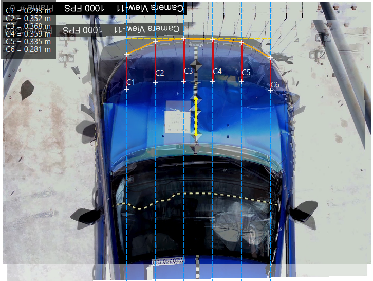

# NHTSA example data - 2024 Jeep Compass

This directory contains two high-speed video frames provided as example input data for CRASH3Vision.

## Example result

## Reference project

A preconfigured CRASH3Vision project is included as `crash3vision_reference_project.json`.

It can be loaded directly to reproduce the example workflow without repeating image alignment, calibration and C1-C6 marking from scratch.

## Test identification

- Agency: National Highway Traffic Safety Administration (NHTSA)
- Program: New Car Assessment Program (NCAP)
- Vehicle: 2024 Jeep Compass 4x4 5-Door SUV
- NHTSA number: M20240300
- Report: NCAP-KAR-24-001
- Test date: 2024-05-22
- Final report date: 2024-06-06
- Test: Full frontal rigid barrier impact
- Impact velocity: 55.64 km/h
- Test weight: 1815.0 kg

## Frames

- `reference_vehicle_frame_000.png`: Camera View 11, 1000 fps, frame 0; vehicle immediately before impact.
- `deformed_vehicle_frame_300.png`: Camera View 11, 1000 fps, frame 300; vehicle after the impact event, with frontal deformation visible.

At 1000 fps, frame 300 corresponds to approximately 0.300 s after frame 0.

The example images are oriented according to the current CRASH3Vision marking convention, with the front of the vehicle facing upward.

## NHTSA crush-profile reference values

The final NHTSA report provides the following frontal crush measurements:

| Measurement | Crush |
| --- | ---: |
| C1 | 342 mm |
| C2 | 373 mm |
| C3 | 370 mm |
| C4 | 362 mm |
| C5 | 348 mm |
| C6 | 253 mm |
| L (C1-C6) | 1192 mm |

These NHTSA values are included as documentary reference, not as automatic acceptance criteria for measurements made with CRASH3Vision. Equivalent results require equivalent image geometry, calibration, reference contour and measurement procedure.

## Source and integrity

Source report:

- `NCAP-KAR-24-001`
- NHTSA number `M20240300`
- 2024 Jeep Compass 4x4 5-Door SUV
- NHTSA NCAP full frontal rigid barrier impact test

The source PDF is not included in this repository. Its SHA-256 is:

- PDF SHA-256: `a1ab4f584370e87c087393992d3ef1be33ae85309e685f63efab1b532dc1bb79`

Example image hashes:

- `reference_vehicle_frame_000.png`
  - SHA-256: `9bd4419395e0a3dbc94afec1c657cf57f722751c3bfe3ec2a51468733090b11e`
- `deformed_vehicle_frame_300.png`
  - SHA-256: `f2e622d17e1f3487dc25e6e18e354534b08f04b6a68fb65c46d552635868011f`

## Intended use

These files are provided as example data for learning, demonstration and manual testing of the CRASH3Vision workflow.

They may be useful for testing image loading, alignment, calibration workflows and C1-C6 marking. They do not constitute a certified reconstruction or an independent validation of the NHTSA test results.

## Attribution

Source data and imagery: U.S. Department of Transportation / National Highway Traffic Safety Administration (NHTSA), NCAP test M20240300.

Please preserve this attribution and the test/report identifiers when redistributing or deriving example material from these files.
